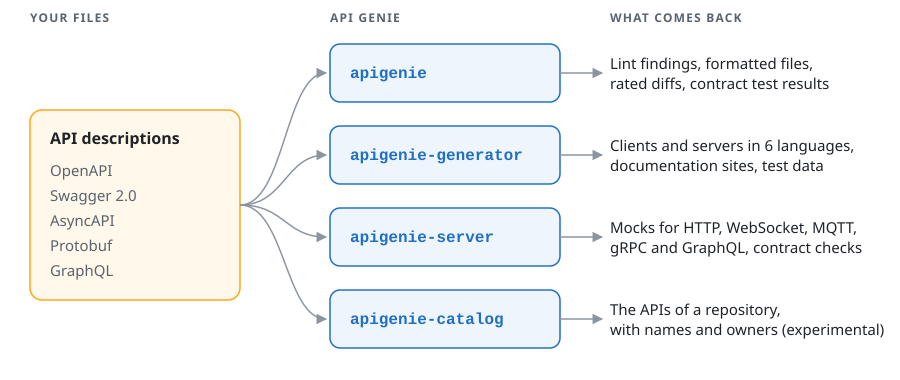

<p align="center">
  
</p>

<p align="center">
  Lint, diff, mock and generate code from OpenAPI, Swagger 2.0, AsyncAPI, Protobuf and GraphQL files.
</p>

<p align="center">
  <a href="https://github.com/mykulyak/api-genie/releases/latest"></a>
  <a href="https://www.npmjs.com/package/@mykulyak/api-genie"></a>
  <a href="https://hub.docker.com/r/mykulyak/apigenie"></a>
  <a href="https://github.com/mykulyak/api-genie/releases"></a>
  <a href="https://github.com/mykulyak/api-genie-action"></a>
  
  <a href="https://apigenie.pl/downloads"></a>
</p>

<p align="center">
  <a href="https://apigenie.pl/docs/quickstart">Quickstart</a> ·
  <a href="https://apigenie.pl/docs/reference/cli/overview">CLI reference</a> ·
  <a href="https://apigenie.pl/downloads">Downloads</a> ·
  <a href="https://github.com/mykulyak/api-genie/releases">Releases</a>
</p>

This repository holds the [releases](https://github.com/mykulyak/api-genie/releases) of API Genie
and the release news. The documentation is at [apigenie.pl](https://apigenie.pl/docs/quickstart).

<picture>
  <source media="(prefers-color-scheme: dark)" srcset=".github/assets/overview-dark.svg">
  
</picture>

## Install

```sh
brew install mykulyak/apigenie/apigenie
```

Or run it without installing, with npm or Docker:

```sh
npx @mykulyak/api-genie --help
docker run --rm -v "$PWD:/mnt/data" mykulyak/apigenie:latest --help
```

The [latest release](https://github.com/mykulyak/api-genie/releases/latest) also has archives for macOS
(Apple silicon), Linux (x64) and Windows (x64), `.deb` and `.rpm` packages, and `SHA256SUMS`. The
macOS binaries are signed and notarized. [Downloads](https://apigenie.pl/downloads) lists every
option.

## What the linter says about a file

```sh
apigenie lint openapi.yaml
```

```text
  764:6   warning  Unused shared component                                 unused-shared-component
  781:8   error    Schema with integer type does not define proper format  schema-format-defined

  2 issues (1 error, 1 warning)
  0 errors, 1 warning are potentially auto-fixable
```

Errors make the command exit with status 1. `apigenie lint --fix` applies the safe fixes and keeps
your comments.

## A renamed field, caught

```sh
git show main:shop.proto > main.proto
apigenie diff main.proto shop.proto
```

```text
shop.proto
  19  1      breaking  Modified message 'Customer'
  19  1  non-breaking    Removed field 'fax'
  25  3      breaking    Modified field 'full_name'
  25  3      breaking      Modified field name
```

A breaking change makes `apigenie diff` exit with status 1, so the pull request stops there.

## The four commands

| Command | What it does |
| --- | --- |
| `apigenie` | Lints, formats, compares, bundles and converts API descriptions, and tests a live API against its contract. |
| `apigenie-generator` | Generates clients and servers in TypeScript, Java, Go, Python, C# and Elixir, documentation sites, test data and validation schemas from OpenAPI, Swagger 2.0, AsyncAPI and JSON Schema documents. |
| `apigenie-server` | Mocks HTTP, WebSocket, MQTT, gRPC and GraphQL APIs from their descriptions, and checks a real server's traffic against them. |
| `apigenie-catalog` | Lists the API descriptions of a git repository and keeps their names and owners in `apigenie.yaml`. Experimental. |

The [CLI reference](https://apigenie.pl/docs/reference/cli/overview) describes each command and its
options.

## Add the check to CI

[`mykulyak/api-genie-action`](https://github.com/mykulyak/api-genie-action) installs the CLI on
Linux, macOS and Windows runners, shows the changes as annotations on the files and posts the
report as a comment on the pull request:

```yaml
on: pull_request
jobs:
  api:
    runs-on: ubuntu-latest
    steps:
      - uses: actions/checkout@v4
      - uses: mykulyak/api-genie-action@v0
        with:
          command: diff
          files: api/openapi.yaml
```

The step fails on a breaking change against the base of the pull request.

## Report a problem

Open an [issue](https://github.com/mykulyak/api-genie/issues) with the command, the version from
`apigenie --version`, and the smallest file that shows the problem.

## News

### 2026-10-25

The mock server is now `apigenie-server`, with a document store for CRUD
resources and several services in one process, and a fourth binary,
`apigenie-catalog`, keeps a repository's API catalog. `apigenie-generator`
applies OpenAPI overlays before generating, and the three binaries share one
table of exit statuses. See the [release notes of
0.10.0](https://github.com/mykulyak/api-genie/releases/tag/cli-0.10.0).

### 2026-10-10

API Genie 0.9.0 translates OpenAPI, Swagger 2.0, AsyncAPI, Protobuf and GraphQL
files, and its mock server (`apigenie-mock`, now `apigenie-server`) mocks and
contract-checks HTTP, WebSocket, MQTT, gRPC and GraphQL APIs. The new GitHub
Action `mykulyak/api-genie-action` installs the CLI in workflows on Linux, macOS
and Windows. See the [release notes of
0.9.0](https://github.com/mykulyak/api-genie/releases/tag/cli-0.9.0).

### 2025-11-13

Released `0.8.2` of the API Genie CLI tool, which uses signed binaries for
macOS.

### 2024-09-02

Released `0.8.0` of the API Genie CLI tool, which adds many improvements. They
include performance improvements, Docker builds and (experimental) OpenAPI
differ. Read more about them on the
[website](https://apigenie.pl/docs/reference/cli/overview).

### 2024-05-13

Released `0.4.1` of the API Genie CLI tool, which adds build for Windows 8 and
newer. Read more about them on the
[website](https://apigenie.pl/docs/reference/cli/overview).

### 2024-05-05

Released `0.4.0` of the API Genie CLI tool, which provides two more commands,
`generate data` and `generate doc html`. Read more about them on the
[website](https://apigenie.pl/docs/reference/cli/overview).

### 2024-04-25

Released `0.2.0` of the API Genie CLI tool, which provides two new commands,
`diff` and `i18n`. Read more about them on the
[website](https://apigenie.pl/docs/reference/cli/overview).

### 2024-04-15

Released `0.1.0` of the API Genie CLI tool, which provides two commands,
`format` and `lint`. Read more about them on the
[website](https://apigenie.pl/docs/reference/cli/overview).
